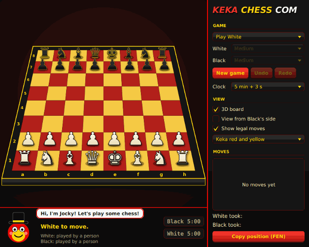

# KEKA CHESS COM

A chess engine in Java with a pseudo-3D JavaFX board, built as an
object-oriented design project. You can play another person or the computer,
at four levels of difficulty, with a clock, or watch the computer play itself.
Jocky the mascot cheers you on, and his hat hides a second game: cheating
chess, which in turn hides a third.



## Status

Working now:

- The board, the starting position and a text view of it
- Movement for all six pieces, including blocking and captures
- Check, checkmate and stalemate. Only legal moves are offered: a move that
  leaves your own king in check is never in the list.
- Castling, en passant and promotion
- Draws by the fifty-move rule, threefold repetition and insufficient material
- Undo and redo
- Loading and saving positions as FEN
- Turn handling and a console front end
- A JavaFX board: click a piece to see its moves, click a highlighted square
  to play one
- A pseudo-3D view, with the board in perspective and the pieces standing on
  it, or a flat view from above; either can be seen from White's or Black's
  side
- Four colour themes, a move list, captured pieces, a highlight on a king in
  check, and keyboard shortcuts
- A chess clock with an increment per move, in five time controls
- Jocky, a mascot who comments on the game
- Cheating chess, a variant with secretly transformed pieces, reached by
  clicking Jocky's hat, and its angry chaotic mode (see below)
- A status bar (whose turn, check, checkmate, the draws) and a dialog for
  choosing the piece when a pawn promotes
- Play as White or Black against the computer, which thinks on a background
  thread so the window never freezes
- A computer opponent that searches ahead with alpha-beta pruning, at Easy,
  Medium and Hard levels (2, 4 and 5 half-moves deep), plus a level that
  plays random moves

- Undo and redo buttons. Against the computer, Undo takes back your move and
  its reply together.
- Computer v computer games, with a line for each side showing its average
  thinking time and positions examined per move
- A tournament runner that plays strategies against each other and prints
  win rates

## Running it

You need JDK 17 or newer and Maven. From the project folder, start the board
with:

```
mvn javafx:run
```

Maven downloads JavaFX on the first run. Recent JDKs print a few warnings
about JavaFX's native access when it starts; they are harmless.

The panel on the right has the game settings, the view options and the move
list. Keyboard shortcuts:

| Keys | Action |
|---|---|
| Ctrl+N | New game |
| Ctrl+Z, Ctrl+Y | Undo, redo |
| Ctrl+F | Flip the board to the other side |
| Ctrl+D | Switch between the 3D and flat views |

### Cheating chess

Click Jocky's hat. The window turns from red, yellow and black to purple,
green and white, Jocky turns shady, and the game becomes cheating chess
against the computer. Click the hat again to go back.

- **Transformations.** Before the first move, click any of your non-pawn
  pieces and choose what it really is: queen, rook, bishop, knight or pawn. It
  keeps its square and its looks and moves as its new self. A badge on each of
  your transformed pieces shows its real power; the computer's look perfectly
  normal. Kings cannot be transformed.
- **Cheat points.** You pay for this from a budget of 20 cheat points. Pieces
  are worth pawn 1, knight 3, bishop 3, rook 5, queen 9, and a transformation
  costs the difference: a knight made a queen costs 6. Making a piece weaker
  pays the difference back, so demoting your queen to a pawn turns 20 points
  into 28. There is no limit on how many pieces you change, only on the
  points. They are for the set-up only: once you press Start, unspent points
  are worth nothing.
- **Green and red marks.** When you pick up a piece, a green mark is a move
  it could make as what it looks like. A red mark is a move only its secret
  identity allows: playing it gives the piece away to anyone watching.
- **No check.** Nobody has to answer a check, because nothing is certain to
  be what it seems. Capturing the king wins.
- **Challenge!** Instead of moving, challenge the move just played. It
  succeeds if the piece that moved is transformed, or if its owner fiddled
  the clock that turn. You then choose a reward and still get your move.
- **Rewards.** Reveal the piece for good; strip it, so that it becomes what
  it looks like; jail it for two turns; spend one of your three switch tokens
  to transform one of your own pieces again; take two moves in a row; or
  steal 30 seconds from the other clock.
- **Penalties.** If the move was honest, one of these is drawn at random: you
  lose your turn, lose 30 seconds, lose a switch token, or have one of your
  own hidden pieces exposed.
- **The clock.** "Fiddle the clock" secretly adds 20 seconds to your time, up
  to three times a game (twice in angry chaotic mode). So can the computer,
  and its clock is in plain view. A side caught fiddling loses 40 seconds.

The computer plays by the same rules and sees only what an opponent may. It
never guesses: it challenges only what it could have seen. But it is not
always watching. It spots about three in ten of your red moves and about half
of your clock fiddles, so using a transformed piece's power is a gamble, not
a certainty of being caught.

### Angry chaotic cheating

In cheating chess, choose "Angry chaotic" from the mode list and say yes to
the question that tries to stop you. Everything turns red and black, and
Jocky loses his temper. The mode is meant to be unnerving: the edges of the
window throb red like a pulse, and every few seconds the screen shakes, tears,
flashes up a message, or opens a pair of eyes somewhere. None of it strobes;
each effect appears once and fades.

- Pawns can be transformed too, out of the same 20 cheat points: a pawn made
  a queen costs 8. Each side has five switch tokens and may challenge only
  three times a game.
- **Disrupt.** Once a game, a successful challenger may instead expose a
  second hidden piece, make one square safe from capture for two or three
  turns, or bring back their most valuable captured piece.
- **Debuffs.** A failed challenge never costs the turn here. Most often it
  brings a debuff for a turn or two: every piece is drawn the same colour;
  half the board is blacked out; your clicks land on the opposite square;
  your pieces must stay on their own colour of square; your queen cannot
  move; your pawns cannot move; you cannot capture; or your queen, rooks and
  bishops slide only two squares. It can also cost time, a token or an
  exposed piece, as in the ordinary cheating mode.
- **Events** strike at random, each lasting two or three turns:
  - a **rocket** blows a two-by-two crater that nothing can enter or cross;
  - a **storm** of force 1 to 5 cuts how far queens, rooks and bishops can
    slide, down to a single square at force 5;
  - a wheel is spun for where **the floor is lava**: the light or the dark
    squares of one file;
  - a **roll call** lets only pieces that look like one kind move (pawns,
    knights, bishops or rooks), and a side with none to move misses its turn;
  - a **ceasefire** forbids every capture;
  - a **time warp** swaps the two clocks;
  - **fog** hides the middle four rows of the board;
  - you get **hacked**: every piece on screen jumps to a random square a
    couple of times a second, and the board ignores your clicks, until you
    beat a mini-game by pressing six muddled buttons in order from 1. A
    wrong press muddles them again. Nothing really moves, and your clock
    keeps running.

  Pieces caught in a crater or in lava are lost. Kings are spared, so the
  weather never decides the game by itself.

There is also a console version, which needs only the JDK:

```
javac -d out src/main/java/chess/Main.java src/main/java/chess/engine/*.java
java -cp out chess.Main
```

```
White to move > e2e4

  +------------------------+
8 | r  n  b  q  k  b  n  r |
7 | p  p  p  p  p  p  p  p |
6 | .  .  .  .  .  .  .  . |
5 | .  .  .  .  .  .  .  . |
4 | .  .  .  .  P  .  .  . |
3 | .  .  .  .  .  .  .  . |
2 | P  P  P  P  .  P  P  P |
1 | R  N  B  Q  K  B  N  R |
  +------------------------+
    a  b  c  d  e  f  g  h
Black to move >
```

Castle by moving the king two squares (`e1g1`). A pawn reaching the last rank
becomes a queen unless you add a letter: `e7e8n` promotes to a knight.
`undo` and `redo` step through the game, `fen` prints the position and
`fen <FEN>` loads one.

## Tests

```
mvn test
```

The tests use JUnit 5, which Maven (or the IDE) downloads on the first run.
There are 474 of them. None needs a window, so they run anywhere. A GitHub Actions workflow
(`.github/workflows/test.yml`) runs them on every push.

They cover every piece's movement and each rule, and compare move counts
against the published perft numbers: the starting position to depth 5
(4,865,609 move sequences) and six standard positions, loaded from FEN, that
exercise castling, en passant and promotion. Perft plays and takes back every
move on one board, so it tests undo as hard as it tests move generation. The
perft tests take around ten seconds.

## Design

There is a [class diagram](docs/class-diagram.md), and the
[engine report](docs/engine-report.md) explains the design decisions, the
patterns used and how the engine is tested.

There are five packages, and dependencies only point downwards in this
list:

| Package | Contents |
|---|---|
| `chess.ui` | The JavaFX front end |
| `chess.cheat` | The rules of cheating chess and its computer opponent |
| `chess.player` | `Player`, and the computer player's threading |
| `chess.ai` | Algorithms for choosing a move |
| `chess.engine` | The rules. No dependency on anything else, or on JavaFX. |

```
Piece (abstract)              colour, type, pseudoLegalMoves(board, from)
├── SlidingPiece (abstract)   slides along lines until something blocks it
│   ├── Rook
│   ├── Bishop
│   └── Queen
├── Knight
├── King
└── Pawn
```

| Class | Responsibility |
|---|---|
| `Piece` and subclasses | How each kind of piece moves |
| `Board` | Which piece is on which square, castling rights and the en passant square; plays and undoes moves; finds attacks, check and legal moves |
| `Move` | One move, including the piece it captured and any promotion |
| `Position` | A square such as `e4` |
| `Game` | A board plus whose turn it is and the moves played; rejects illegal moves; undo and redo; reports the game status |
| `Fen` | Reads and writes positions as FEN text |
| `PieceColor`, `PieceType`, `CastlingSide`, `GameStatus` | Enums |

`Board` calls `piece.pseudoLegalMoves(...)` without knowing which kind of
piece it has, and each subclass answers in its own way. Pieces do not store
their own square. The board is the only place that knows where pieces are,
so the two can never disagree, and pieces can be immutable.

Legal moves are found in two steps. Each piece lists its *pseudo-legal* moves,
which follow its movement pattern but ignore king safety. The board then plays
each one on a copy of itself and throws away any that leave the mover's king
attacked. That single test handles pins, kings walking into attacks and
failing to answer a check.

Undo and redo use the Command pattern. A `Move` is the command object: it
holds what is needed to carry the action out (`board.makeMove`) and to reverse
it (`board.undoMove`), including the captured piece. What a move cannot know
by itself, such as the castling rights before it was played, the board saves
as it plays the move. `Game` keeps two stacks, moves played and moves taken
back, and playing a new move empties the second.

`Piece.create(type, color)` and `Piece.fromSymbol('N')` are factory methods:
promotion and FEN ask for a piece by its label without naming the subclass.

Attacks are a separate question from moves (`piece.attacks(...)`), because a
pawn attacks diagonally even onto an empty square and does not attack the
square in front of it.

### Players and the GUI

| Class | Responsibility |
|---|---|
| `ChessApp` | The JavaFX application: the window, the side panel, starting a new game |
| `GameController` | Asks the player to move for a move, plays it, asks the other; undo and redo |
| `BoardView` | Draws the board from a `BoardSource`; lets a person pick a move by clicking |
| `BoardSource` | Interface: what to draw and which moves to offer. `GameBoardSource` is ordinary chess, `CheatBoardSource` is cheating chess as one side sees it. |
| `Jocky`, `JockyLines` | The mascot, drawn from shapes, and what he says in each of his three moods |
| `CheatSession` | Runs a game of cheating chess: transformations, turns, challenges, clock cheats |
| `ChessClock`, `TimeControl` | The clock: time per side, increments, running out |
| `ChaosEffects` | The glitching question, pop-ups, announcements and dread of angry chaotic mode |
| `HackPuzzle` | The mini-game that ends a hack |
| `Projection` | Where each point of the board appears on screen, flat or in perspective |
| `BoardTheme`, `PieceArt`, `PieceGlyphs` | The colour schemes, and how a piece is painted |
| `MoveListPanel`, `MoveListText` | The move list and captured pieces, and their wording |
| `Selection` | The click rules: which piece is picked up and where it may go |
| `PromotionDialog` | Asks which piece a pawn becomes |
| `StatusBar`, `StatusText` | The line under the board, and its wording |
| `StatsPanel`, `StatsText` | The computer players' figures, and their wording |
| `Player` | Interface: something that can be asked for a move |
| `HumanPlayer` | Answers when the person clicks on the `BoardView` |
| `AIPlayer` | Answers by running a `MoveStrategy` on a background thread |
| `MoveStrategy` | Interface: an algorithm for choosing a move |
| `RandomStrategy` | Any legal move, each equally likely |
| `MinimaxStrategy` | Searches every line to a fixed depth |
| `AlphaBetaStrategy` | The same result as minimax, skipping lines that cannot matter |
| `SearchStrategy` | What those two share: depth, scoring of mate and draws, counters |
| `Evaluator` | Interface: scores a position without looking ahead |
| `MaterialEvaluator`, `PieceSquareEvaluator` | Piece values; piece values plus a bonus for good squares |
| `Difficulty` | The levels offered in the GUI, and the strategy for each |
| `MeasuredStrategy` | Wraps any strategy and records its time and positions per move |
| `Tournament` | Plays strategies against each other many times |

**Strategy pattern.** `AIPlayer` holds a `MoveStrategy` and does not know
which algorithm it is. A stronger opponent is a new class implementing the
interface; nothing else changes.

**Observer pattern.** `Game` tells its `GameListener`s after every move, undo
and redo. `BoardView` and `StatusBar` are listeners, so they redraw whoever
made the move, and the engine never mentions the GUI.

**Threads.** A search can take seconds, and a JavaFX window freezes if its
thread is busy. `AIPlayer` copies the board, runs the strategy on that copy
on a background thread, and hands the chosen move back on the JavaFX thread,
which is the only thread that ever touches the `Game` or the window. If a new
game is started while the computer is thinking, `GameController` ignores the
late answer.

### The AI

**Evaluation.** A position is scored in centipawns from White's side: pawn
100, knight 320, bishop 330, rook 500, queen 900, plus a piece-square table
value for where each piece stands (central knights, advanced pawns, a castled
king). The tables are Tomasz Michniewski's "Simplified Evaluation Function".

**Minimax** looks at every sequence of moves to a fixed depth, assuming each
side picks its own best move, and evaluates the positions at the end.
**Alpha-beta** returns exactly the same score while skipping any move once it
is clear the opponent would never allow it. The tests check the two agree at
every depth on a set of positions.

**Move ordering** tries captures first, biggest victim by smallest attacker,
because pruning cuts more when good moves come early. It changes the amount
of work, never the result. From one test position at depth 4:

| Search | Positions visited |
|---|---|
| Minimax | 4,185,553 |
| Alpha-beta, no ordering | 38,608 |
| Alpha-beta, captures first | 7,084 |

The search plays and undoes moves on one board rather than copying it, and
generates pseudo-legal moves, rejecting any that leave the king in check as it
goes. Checkmate scores more than any material and a quicker mate scores more
than a slower one.

### Cheating chess

| Class | Responsibility |
|---|---|
| `CheatGame` | The rules: what each piece really is and what it looks like, king capture, challenges with their rewards and debuffs, and the rockets, storms and lava |
| `CheatLevel` | The two modes and what each allows |
| `CheatAI` | The computer's transformations, moves and challenges |

`CheatGame` reuses the engine rather than copying it. The true position is an
ordinary engine `Board`, which supplies the moves; `CheatGame` adds a second
grid recording what each piece looks like. What a player is allowed to know
is a "belief board": their own pieces as they are and the opponent's as they
appear. The computer searches that board with the same `AlphaBetaStrategy` as
ordinary chess, so it is fooled by disguises exactly as a person would be.

The GUI needed one new abstraction. `BoardView` used to draw a `Game`
directly; it now draws a `BoardSource`, with one implementation for each kind
of game, so the 3D board, themes and click handling are shared.

**Measuring.** `MeasuredStrategy` is a Decorator: it is a `MoveStrategy` that
wraps another, chooses the same moves and records how long each took and how
many positions it examined. The GUI and the tournament both use it, and no
strategy needed changing to be measured.

### How the strategies compare

`Tournament` plays two strategies against each other. The searching
strategies have no randomness, so each game starts with four random moves,
and each random opening is played twice with colours swapped.

```
mvn -q compile
java -cp target/classes chess.ai.Tournament
```

Twenty games per match. W, D and L are the first strategy's results, and
Score counts a draw as half a win.

| First | Second | W | D | L | Score | First: ms and positions a move | Second: ms and positions a move |
|---|---|---|---|---|---|---|---|
| Alpha-beta, depth 2 | Random | 18 | 2 | 0 | 95% | 0.4 ms, 150 | 0 ms, none |
| Alpha-beta, depth 4 | Alpha-beta, depth 2 | 12 | 8 | 0 | 80% | 14 ms, 11,423 | 0.2 ms, 141 |
| Alpha-beta, depth 5 | Alpha-beta, depth 4 | 8 | 11 | 1 | 68% | 135 ms, 117,041 | 14 ms, 11,481 |
| Depth 4 with piece-square tables | Depth 4, material only | 9 | 10 | 1 | 70% | 13 ms, 11,357 | 7 ms, 5,489 |
| Alpha-beta, depth 3 | Minimax, depth 3 | 3 | 14 | 3 | 50% | 2 ms, 1,852 | 30 ms, 32,907 |

What this shows:

- Searching deeper wins. Each level beats the one below it and almost never
  loses to it.
- The piece-square tables are worth having: at the same depth they score 70%
  against material alone.
- Alpha-beta and minimax are equally strong at the same depth, as they should
  be since they compute the same scores, but minimax examines about 18 times
  as many positions to get there.
- There are a lot of draws. The likely cause is repetition, which the search
  cannot see (below); the tournament does not record how each draw came about.

The times are from one laptop and will differ elsewhere; the position counts
will not.

Known weaknesses: the search stops at a fixed depth even in the middle of an
exchange of pieces; it cannot see draws by repetition, so when winning it
sometimes repeats moves into a draw; and it has no special knowledge of
endgames.

**The pseudo-3D board.** There is no 3D graphics library involved. Each
square is a four-sided shape whose corners `Projection` works out with
ordinary perspective: a length at depth `d` squares from the viewer is
multiplied by `20 / (20 + d)`, so the far edge is drawn smaller and the
square board becomes a trapezium. The pieces are drawn upright on top,
smaller the further away they are, from the far row to the near row so that
nearer pieces overlap those behind. The flat view is the same code with the
perspective turned off, and flipping the board only changes which square is
drawn in which row and column. Because the squares are real shapes, a click
lands on the right square in every view with no extra arithmetic.

The colours of the controls are in one stylesheet,
`src/main/resources/chess/ui/keka.css`.

`Selection`, `GameController`, `Projection`, `StatusText`, `MoveListText` and
`AIPlayer` contain no JavaFX, so the click rules, turn-taking, geometry,
wording and threading are all unit-tested without opening a window.

## Using the engine from other code

This is what a GUI or an AI needs:

| Call | Result |
|---|---|
| `new Game()` | A new game, White to move |
| `game.getTurn()` | `PieceColor.WHITE` or `PieceColor.BLACK` |
| `game.getBoard().getPiece(position)` | The `Piece` on a square, or `null` if it is empty |
| `piece.getType()`, `piece.getColor()` | What to draw |
| `game.legalMovesFrom(position)` | The moves of one piece, e.g. for highlighting squares |
| `game.legalMoves()` | Every move for the side to move |
| `game.makeMove(move)` | Plays a move and switches the turn |
| `game.getStatus()` | `IN_PROGRESS`, `CHECK`, `CHECKMATE`, `STALEMATE` or one of three `DRAW_BY_...` values, for the side to move |
| `status.isGameOver()`, `status.isDraw()` | Whether play has stopped, and whether nobody won |
| `game.undo()`, `game.redo()`, `game.canUndo()`, `game.canRedo()` | Step back and forward, and whether to enable the buttons |
| `game.getLastMove()`, `game.getMoveHistory()` | For highlighting the last move or listing the game |
| `game.addListener(listener)` | Be told after every move, undo and redo |
| `Game.fromFen(text)`, `game.toFen()` | Start from any position; save the current one |
| `game.isInCheck()` | Whether the side to move is in check |
| `move.isPromotion()`, `move.getPromotion()` | Whether a pawn promotes, and to which `PieceType` |
| `move.isCastling()`, `move.isEnPassant()`, `move.isCapture()` | What kind of move it is, e.g. for sounds or animation |
| `new Board(board)` | An independent copy, for trying moves out |
| `board.legalMoves(color)` | Legal moves on any board, e.g. inside an AI search |
| `board.makeMove(move)`, `board.undoMove(move)` | Try a move and take it back, without copying the board |

Things a GUI has to allow for:

- **Promotion.** A pawn reaching the last rank has four moves with the same
  `from` and `to`, one per piece. When more than one move matches the squares
  the user clicked, ask which piece and pick the move whose `getPromotion()`
  matches.
- **Castling** is the king's move of two squares (`e1` to `g1` or `c1`). The
  engine moves the rook, so redraw the whole board after a move rather than
  just the two squares clicked.
- **En passant** removes a pawn that is not on the destination square, for
  the same reason.
- When `getStatus().isGameOver()` is true, `legalMoves()` is empty and
  `makeMove` rejects everything, but `undo()` still works. After checkmate,
  `getTurn()` is the loser. The draws are applied automatically rather than
  waiting for a player to claim them.

Things an AI has to allow for:

- **Search on your own copy.** `new Board(game.getBoard())` gives the search a
  board the GUI is not drawing from. Then use `makeMove` and `undoMove` on
  that copy instead of copying again at every node. Moves must be undone in
  reverse order, and a copy cannot undo moves played before it was made.
- **`Game` is not thread-safe.** Search on a background thread, but call
  `game.makeMove` with the chosen move on the JavaFX thread.
- `board.legalMoves(color)` knows nothing about the fifty-move and repetition
  draws, which need the game's history. Checkmate and stalemate are simply an
  empty list, with `board.isInCheck(color)` telling them apart.

Squares are `new Position(file, rank)` with both numbers from 0 to 7:
file 0 is the a-file and rank 0 is rank 1, White's back row.
`Position.of("e4")` does the same from text. To draw with row 0 at the top of
the screen, use `row = 7 - rank`.
