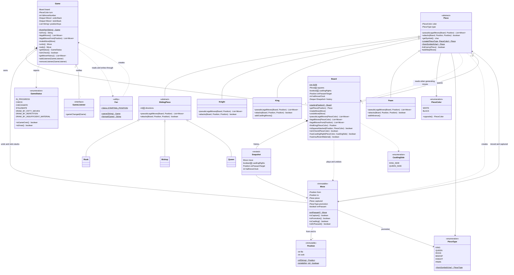

# Engine class diagram

The `chess.engine` package. GitHub draws the diagram below automatically. To
get an image for the report, paste the block into <https://mermaid.live> and
export it as PNG or SVG.

Getters, `equals`/`hashCode`/`toString`, the package-private set-up methods
(`setPiece` and friends) and some parameter lists are left out to keep it
readable. `Snapshot` is a private class nested inside `Board`.

## How to read it

- **Inheritance** (hollow triangle): `Rook`, `Bishop` and `Queen` add nothing
  but their directions to `SlidingPiece`. `Knight`, `King` and `Pawn` each
  implement the two abstract methods of `Piece` themselves.
- **Composition** (filled diamond): a `Game` owns its `Board`, and a `Board`
  owns its undo `Snapshot`s. Neither part is shared with anything else.
- **Aggregation** (hollow diamond): a `Board` holds `Piece` objects, but
  pieces are immutable and a copied board shares them with the original.
- **Observer**: `Game` holds `GameListener`s and tells them when it changes.
  The classes that implement the interface are in the GUI, outside this
  package, which is the point: the engine does not know them.
- **Dependency** (dashed arrow): one class uses another without keeping it.
  `Piece` reads the `Board` it is asked about but never stores it, which is
  what keeps the board the only owner of where pieces are.
